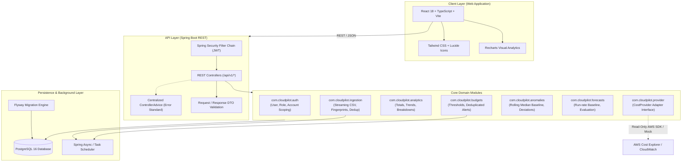

# CloudPilot System Architecture

## 1. Architectural Style: Modular Monolith

CloudPilot is designed as a **modular monolith**. It packages domain capabilities into clean, independently testable Java packages and bounded modules within a single cohesive deployable Spring Boot artifact. This avoids unnecessary network overhead, distributed transaction complexities, and microservice operational costs while strictly enforcing separation of concerns.

## 2. Module Boundaries & Responsibilities

| Module Package | Responsibility | Inbound Dependencies | Outbound Dependencies |
|---|---|---|---|
| `com.cloudpilot.common` | Shared DTOs, custom exceptions, response wrappers, utility classes | All | None |
| `com.cloudpilot.auth` | Authentication, JWT token lifecycle, role-based authorization | `common` | `cloud_accounts`, `users` DB tables |
| `com.cloudpilot.ingestion` | Streaming CSV parser, file validation, batch persistence, dedup key generation | `common`, `auth` | `billing_imports`, `cost_records` |
| `com.cloudpilot.analytics` | High-performance aggregated queries, time-series, dimension slicing | `common`, `auth` | `cost_records` |
| `com.cloudpilot.budgets` | Budget limits, threshold progress evaluation, alert event generation | `common`, `auth`, `analytics` | `budgets`, `budget_alerts` |
| `com.cloudpilot.anomalies` | Statistical baseline calculation, spike detection, finding review | `common`, `auth`, `analytics` | `cost_anomalies` |
| `com.cloudpilot.forecasts` | Month-to-date linear run-rate projection, accuracy scoring | `common`, `auth`, `analytics` | `cost_forecasts` |
| `com.cloudpilot.provider` | `CostProvider` interface, AWS Cost Explorer adapter, mock fallback adapter | `common` | External AWS SDK |

## 3. Core Safety Principles
1. **Read-Only Infrastructure:** CloudPilot queries costs and metrics. It contains **zero** mutation, shutdown, termination, or resizing operations against cloud providers.
2. **Defensive Ingestion:** Streams files in bounded chunks (1,000–5,000 rows), validates each row independently, isolates malformed rows without failing the entire batch, and guarantees zero double-counting via SHA-256 record hashes.
3. **Monetary Precision:** All money values are strictly mapped to `BigDecimal` in Java and `NUMERIC(19, 6)` in PostgreSQL. No floating-point rounding errors exist in any aggregation or threshold calculation.
4. **Security in Depth:** Every query is filtered by authenticated user and tenant/account context; endpoints enforce `@PreAuthorize`; error handlers never expose stack traces or SQL error text to clients.
