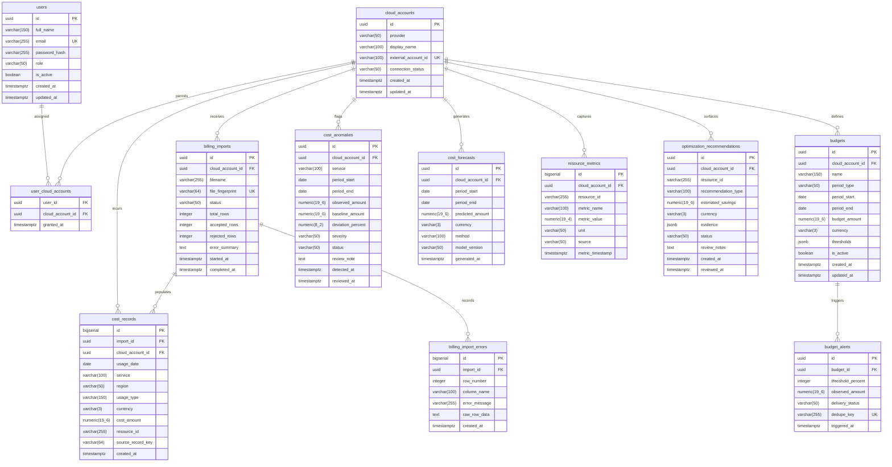

# CloudPilot Entity-Relationship Diagram (ERD) & Database Schema

## 1. Relational ER Diagram

## 2. Table Specifications & Indexes

### `users`
- Primary Key: `id` (UUID)
- Unique: `email`
- Index: `idx_users_email` ON (`email`)
- Enums / Values: `role` IN (`ADMIN`, `ENGINEER`, `BUDGET_OWNER`, `VIEWER`)

### `cloud_accounts`
- Primary Key: `id` (UUID)
- Unique: `external_account_id`
- Index: `idx_cloud_accounts_provider` ON (`provider`, `connection_status`)

### `billing_imports`
- Primary Key: `id` (UUID)
- Foreign Key: `cloud_account_id` REFERENCES `cloud_accounts(id)`
- Unique: `file_fingerprint` (Prevents duplicate physical file re-uploads)
- Index: `idx_imports_account_status` ON (`cloud_account_id`, `status`)

### `cost_records`
- Primary Key: `id` (BIGINT GENERATED ALWAYS AS IDENTITY)
- Foreign Key: `import_id` REFERENCES `billing_imports(id)` ON DELETE CASCADE
- Foreign Key: `cloud_account_id` REFERENCES `cloud_accounts(id)`
- Unique: `idx_cost_records_dedup` ON (`cloud_account_id`, `source_record_key`)
- Index: `idx_cost_records_date_service` ON (`cloud_account_id`, `usage_date`, `service`)
- Index: `idx_cost_records_import` ON (`import_id`)

### `budgets`
- Primary Key: `id` (UUID)
- Foreign Key: `cloud_account_id` REFERENCES `cloud_accounts(id)`
- Index: `idx_budgets_account_active` ON (`cloud_account_id`, `is_active`)

### `budget_alerts`
- Primary Key: `id` (UUID)
- Foreign Key: `budget_id` REFERENCES `budgets(id)`
- Unique: `dedupe_key` (Format: `{budgetId}:{periodStart}:{thresholdPercent}`)
  *Guarantees zero duplicate alerts for identical threshold breaches in the same billing cycle.*

### `cost_anomalies`
- Primary Key: `id` (UUID)
- Foreign Key: `cloud_account_id` REFERENCES `cloud_accounts(id)`
- Index: `idx_anomalies_account_detected` ON (`cloud_account_id`, `detected_at`, `status`)
